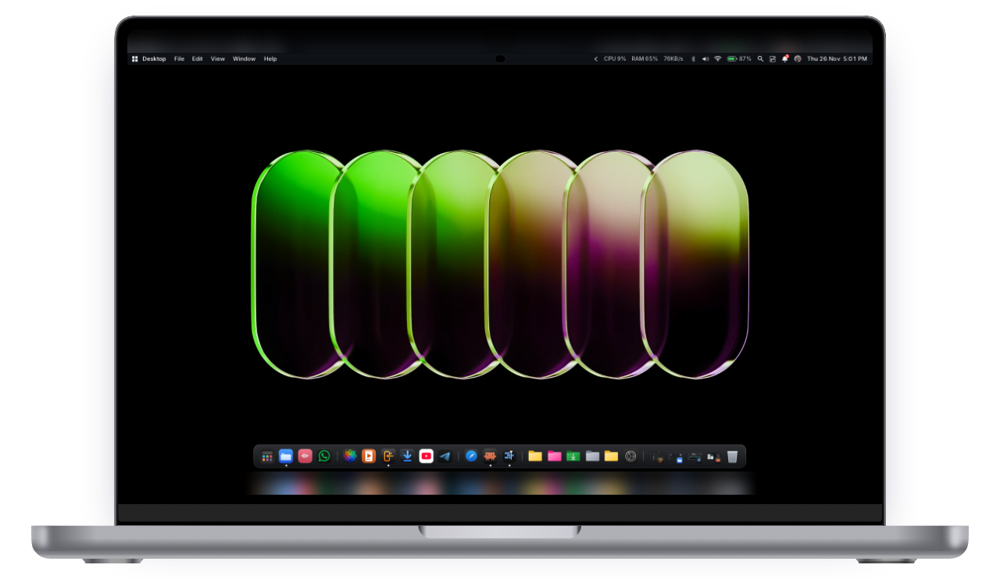
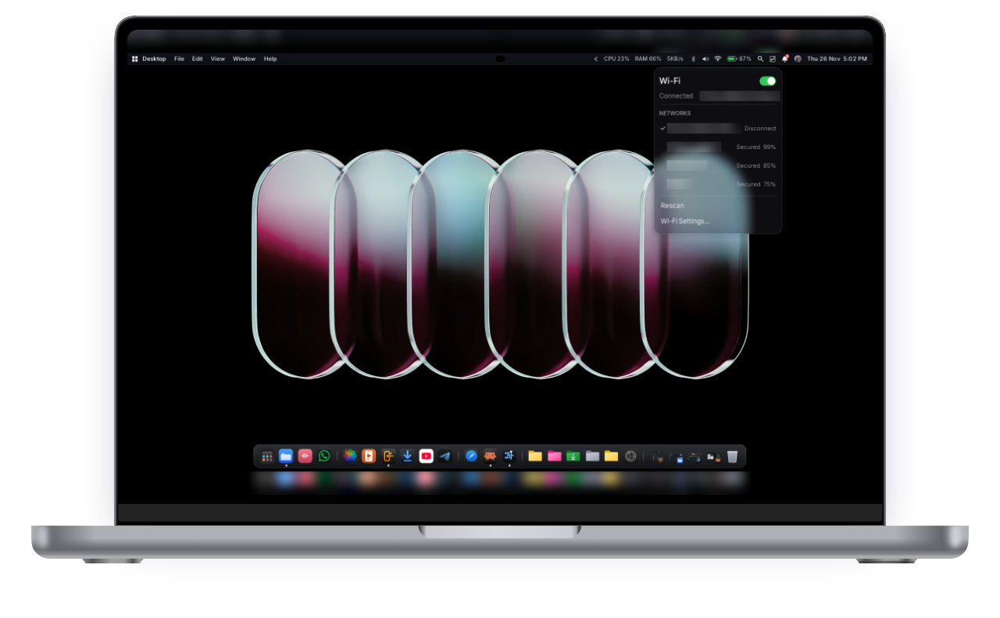
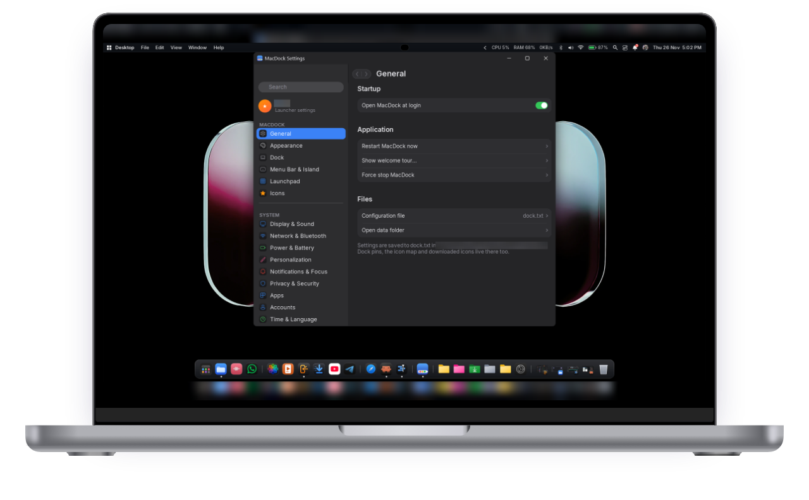
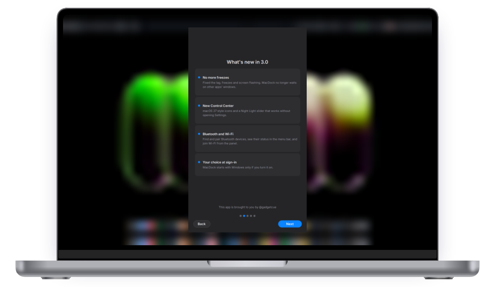
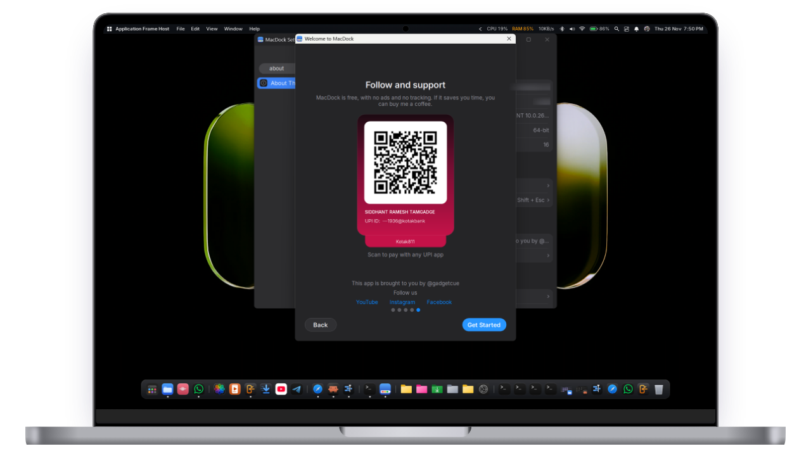

# MacDock

A macOS-style desktop shell for Windows 11, written in C# (WinForms). It builds with the compiler that ships with Windows, so no SDK is needed.



By [@gadgetcue](https://github.com/gadgetcue) · [YouTube](https://www.youtube.com/@gadgetcue) · [Instagram](https://www.instagram.com/gadgetcue) · Telegram

See the [changelog](CHANGELOG.md) for what's new in v3.0.

## Installation guide
**Requirements:** Windows 11 (Windows 10 mostly works), x64, .NET Framework 4.x (already part of Windows). No admin rights and no SDK needed.

**Only one MacDock install is supported.** Installing again, or installing a newer version, replaces the existing one in `%LOCALAPPDATA%\MacDock`. Do not keep several copies or versions side by side. Install from File Explorer by double-clicking the installer; do not launch it from a sandboxed or packaged app's shell (such as a terminal inside another app), because per-user paths are redirected there and the install or restart can fail with a "path does not exist" popup.

### Option A: single-file installer (easiest)
1. Download `MacDock-Setup.exe` from the [Releases page](https://github.com/gadgetcue/MacDock/releases/latest). Optionally check its SHA256 against the release notes: `certutil -hashfile MacDock-Setup.exe SHA256`.
2. Double-click it and press **OK** on the prompt. If SmartScreen says "Windows protected your PC", click **More info > Run anyway**.
3. Setup stops any running MacDock, installs to `%LOCALAPPDATA%\MacDock`, adds a Start Menu shortcut and a *Settings > Apps > Installed apps* entry, sets the dock to use the integrated GPU, asks whether to start it at sign-in, and starts the dock. Start at login is off unless you say yes (or turn it on in MacDock Settings); only then is one at-logon task, `MacDockGuard`, created. There is no every-minute task.
4. Silent install: `MacDock-Setup.exe /S`. It never turns start at login on by itself (an earlier choice is kept).

### Option B: zip + `Install.bat`
1. Download `MacDock-v3.0.zip` from the Releases page (check it with `certutil -hashfile MacDock-v3.0.zip SHA256`).
2. Extract it to any folder (right-click > Extract All).
3. Double-click `Install.bat`. It copies `bin`, `icons` and `dark-icons` to `%LOCALAPPDATA%\MacDock`, creates the Start Menu shortcut and starts the dock. It does not start at login until you turn that on in Settings.

If Defender blocks or quarantines it, see [Why does Windows Defender flag MacDock?](#why-does-windows-defender-flag-macdock).

### Updating
Open the Apple menu and choose **Check for Updates...**. MacDock reads the latest GitHub release, downloads its `.zip`, and swaps in the new `MacDock.exe` (the old one is kept as `MacDock.exe.old`). It never downgrades, and your pins and settings are untouched. The dock then restarts itself. You can also just run the newer `MacDock-Setup.exe` over the existing install.

### Start, restart, quit
- **Start / restart:** open *MacDock* from the Start Menu, or run `%LOCALAPPDATA%\MacDock\bin\MacDock.exe`.
- **Quit:** quitting from the MacDock menu restores the Windows taskbar. Closing, or force-closing, other apps never quits MacDock.
- **Taskbar stuck hidden** (MacDock was killed while it was hidden): run `MacDock.exe /restore` (or `mac-dock\restore-taskbar.bat` from the repo).

### Uninstall
- **Installed with `MacDock-Setup.exe`:** *Settings > Apps > Installed apps > MacDock > Uninstall*, or run `%LOCALAPPDATA%\MacDock\Setup.exe /uninstall` (add `/S` to skip the prompt).
- **Installed with `Install.bat`:** run `Uninstall.bat` from the extracted folder, or `%LOCALAPPDATA%\MacDock\Uninstall.bat`.

Either way, the taskbar is restored, MacDock is stopped, autostart, the `MacDockGuard` task and the Start Menu shortcut are removed, and the install folder is deleted. Your pins and settings in `%APPDATA%\MacDock` are kept until you delete that folder.

## Why does Windows Defender flag MacDock?
Short version: **it is a false positive**, but it is understandable why it happens.

- **Unsigned, new, self-built.** The exe is built with the C# compiler that ships with Windows and has no code-signing certificate. Unsigned executables with few downloads have no reputation, so SmartScreen and Defender's cloud heuristics treat them cautiously.
- **It does the things a shell does.** MacDock uses global/low-level Windows hooks (keyboard, gestures), enumerates and thumbnails other apps' windows (window enumeration, DWM), applies glass effects with `SetWindowCompositionAttribute`, simulates input, hides or replaces taskbar behavior, and registers startup entries. Heuristic engines associate that combination with keyloggers and droppers, even though here it is used for the dock, menu bar and window previews.
- **What it does not do:** MacDock has no account and no analytics or telemetry code. Its network use is limited to LocalSend transfers with devices on your LAN, the optional macosicons.com icon lookup, and fetching favicons for website pins.

You do not have to take our word for it:
- The source is fully open in this repo. Read it, or build it yourself: `mac-dock\build.bat` (run it from a folder path without a `#` in it).
- Check the download's SHA256 (listed in each release) and upload the file to [VirusTotal](https://www.virustotal.com/); a few engines may flag it heuristically.

**If Defender quarantined it:** Windows Security > Virus & threat protection > Protection history > select the item > Actions > **Restore** (or Allow on device). To stop it being re-flagged, add an exclusion: Virus & threat protection > Manage settings > Exclusions > Add or remove exclusions > Add an exclusion > Folder > `%LOCALAPPDATA%\MacDock`. Then re-run `Install.bat`.

**Help us:** you can report the false positive to Microsoft at <https://www.microsoft.com/en-us/wdsi/filesubmission> (choose "Software developer", upload the exe). Each accepted report improves detection for everyone.
## Features
- **Dock**: magnification, running indicators, drag to reorder, drop files on apps, and a working Recycle Bin. Pins live in `dock.txt` (apps, folders, files, websites, `ms-settings:` links).
- **Genie minimize**: windows are sucked into their dock icon and flow back out, drawn from live window thumbnails.
- **Top menu bar**: Apple-style menu, per-app menus, CPU/RAM readout, Wi-Fi, Bluetooth, volume, battery, clock, and optional hiding of the Windows taskbar.
- **Dynamic Island**: a small pill at the top that springs open for notifications, power events, now-playing media and a hover peek.
- **Window previews**: hover a dock icon to see live thumbnails of its windows (DWM); click one to focus it.
- **Clipboard history**: the Dynamic Island keeps recent copied items so you can peek and re-copy them.
- **Notifications**: Windows notifications are read straight from the system database, so they show up instantly.
- **Control Center**: Wi-Fi, Bluetooth, AirDrop-style tile, Focus, display brightness and sound sliders, using real Windows APIs.
- **Mission Control and Launchpad**: overview of every open window plus an All Apps page; add apps to the dock by dragging.
- **Touchpad gestures**: 4- or 5-finger swipe up/down on a Precision Touchpad opens and closes Mission Control.
- **Spotlight**: global hotkey search.
- **Settings app**: dock, theme and icon options.
- **Icon packs**: `.icns` icon packs in `icons/` and `dark-icons/`, with optional macosicons.com lookup, a "Use original app icons" master switch and your own custom pack (folder or .zip).
- **Web apps**: Brave, Edge and Chrome "Install as app" windows are treated as their own apps.
- **LocalSend**: AirDrop-style file sharing with nearby devices, with a device-picker popup, an Explorer "Send with LocalSend" right-click entry, and automatic port fallback.
- **Downloads and folder fan**: dock folders open as a Fan, Grid or List, with folder colors, rename and drag to the Recycle Bin.
- **Media tile and more Control Center tiles**: now-playing artwork and title, Night light, Project, Battery saver, Airplane mode.
- **Fullscreen aware**: the dock, bar and island hide for fullscreen apps.
- **Native glass**: DWM background blur on the dock, bar, menus and panels.

## Screenshots (v3.0)










Older screenshots are in [`screenshots/v2.3`](screenshots/v2.3).

## Memory use
Since v3.0 MacDock no longer trims its working set and keeps up to 150 MB resident, so Task Manager shows more than the older figures below.

Measured on the v1.5 build on Windows 11 (1920x1080) with the dock idle: **~7-43 MB working set** (about 24 MB average over a minute; Windows trims it), **~92-103 MB private bytes**, and a **peak working set of ~140 MB** since launch (start-up and opening Launchpad). Numbers vary with how many apps you pin and which icon packs you load.
## Videos
- [Demo 1](docs/demo-1.mp4)
- [Demo 2](docs/demo-2.mp4)

## Build from source
Requires only Windows 10/11:

```
cd mac-dock
build.bat
```

`build.bat` builds and deploys the live copy to `%LOCALAPPDATA%\MacDock\MacDock.exe` (flat folder, started by the `MacDockGuard` task); no exe stays in `mac-dock/`. To package your own build, put it in `bin/` next to `icons/` and `dark-icons/` and run `Install.bat`. Run `restore-taskbar.bat` if the taskbar stays hidden.

## Configuration
Edit `mac-dock/dock.txt`. Lines starting with `#` are ignored; `Label | target` sets a custom name; `---` starts the right-hand section; `@hide-taskbar on|off` toggles the taskbar.
An optional macosicons.com API key goes in `dock.txt` as `@macosicons-key = YOUR_KEY` or in the `MACOSICONS_API_KEY` environment variable.

## Support
MacDock is free, with no ads and no tracking. If it saves you time, you can buy me a coffee: scan the QR with any UPI app.


Account holder: **SIDDHANT RAMESH TAMGADGE**

## Credits
Fonts: Inter (SIL Open Font License). Icons in `icons/` and `dark-icons/` belong to their respective authors.

Made by **[@gadgetcue](https://github.com/gadgetcue)**. Follow for updates:
- YouTube: <https://www.youtube.com/@gadgetcue>
- Instagram: <https://www.instagram.com/gadgetcue>
- Telegram: @gadgetcue

