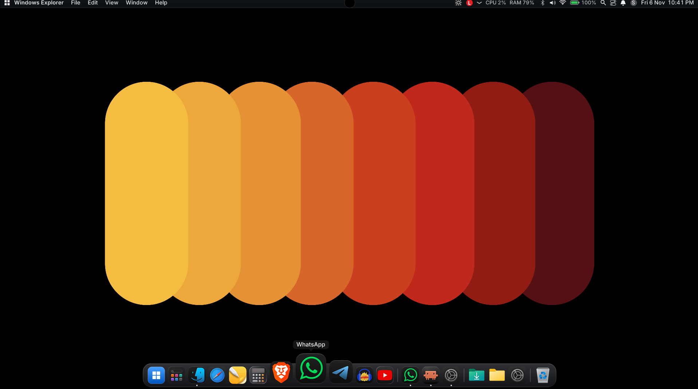
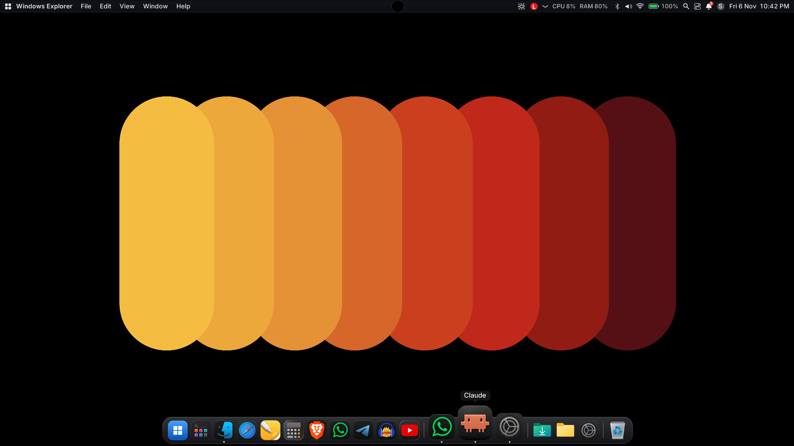
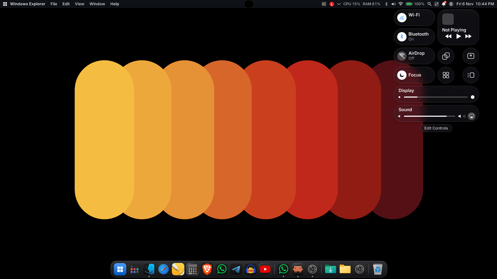
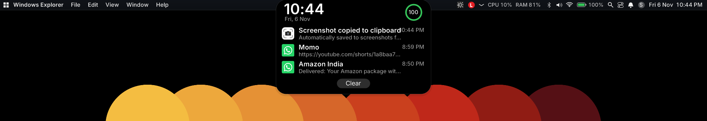

# MacDock

A macOS-style desktop shell for Windows 11, written in C# (WinForms). It builds with the compiler that ships with Windows, so no SDK is needed.



## Features
- **Dock**: magnification, running indicators, drag to reorder, drop files on apps, and a working Recycle Bin. Pins live in `dock.txt` (apps, folders, files, websites, `ms-settings:` links).
- **Genie minimize**: windows are sucked into their dock icon and flow back out, drawn from live window thumbnails.
- **Top menu bar**: Apple-style menu, per-app menus, CPU/RAM readout, Wi-Fi, Bluetooth, volume, battery, clock, and optional hiding of the Windows taskbar.
- **Dynamic Island**: a small pill at the top that springs open for notifications, power events, now-playing media and a hover peek.
- **Notifications**: Windows notifications are read straight from the system database, so they show up instantly.
- **Control Center**: Wi-Fi, Bluetooth, AirDrop-style tile, Focus, display brightness and sound sliders, using real Windows APIs.
- **Mission Control and Launchpad**: overview of every open window plus an All Apps page; add apps to the dock by dragging.
- **Touchpad gestures**: 4- or 5-finger swipe up/down on a Precision Touchpad opens and closes Mission Control.
- **Spotlight**: global hotkey search.
- **Settings app**: dock, theme and icon options.
- **Icon packs**: `.icns` icon packs in `icons/` and `dark-icons/`, with optional macosicons.com lookup.
- **Web apps**: Brave, Edge and Chrome "Install as app" windows are treated as their own apps.
- **Native glass**: DWM background blur on the dock, bar, menus and panels.

## Screenshots








## Videos
- [Demo 1](docs/demo-1.mp4)
- [Demo 2](docs/demo-2.mp4)

## Build
Requires only Windows 10/11:

```
cd mac-dock
build.bat
```

This produces `MacDock.exe`. Run `restore-taskbar.bat` if the taskbar stays hidden.

## Configuration
Edit `mac-dock/dock.txt`. Lines starting with `#` are ignored; `Label | target` sets a custom name; `---` starts the right-hand section; `@hide-taskbar on|off` toggles the taskbar.
An optional macosicons.com API key goes in `dock.txt` as `@macosicons-key = YOUR_KEY` or in the `MACOSICONS_API_KEY` environment variable.

## Credits
Fonts: Inter (SIL Open Font License). Icons in `icons/` and `dark-icons/` belong to their respective authors.
