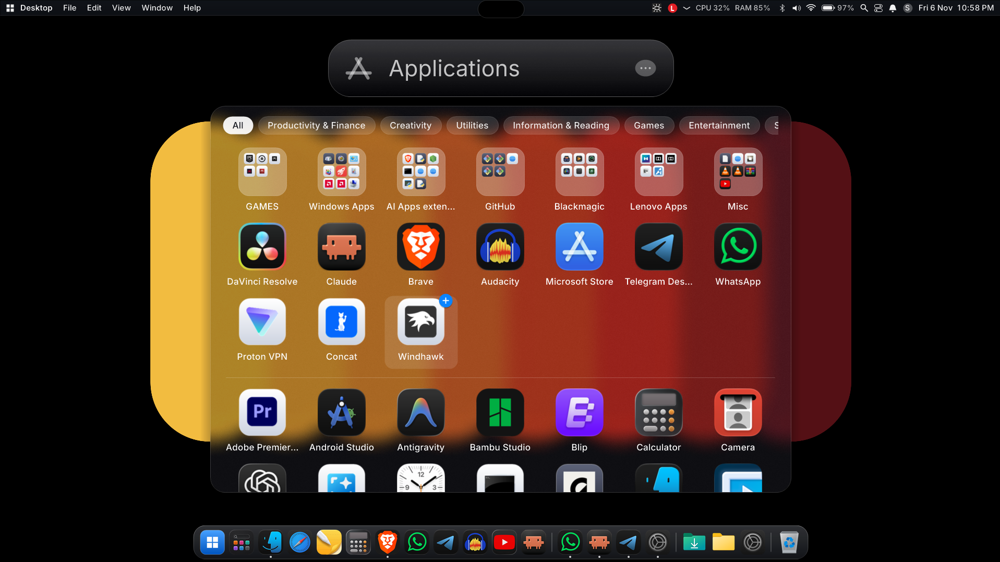

# MacDock

A macOS-style desktop shell for Windows 11, written in C# (WinForms). It builds with the compiler that ships with Windows, so no SDK is needed.


See the [changelog](CHANGELOG.md) for what's new in v1.3.

## Installation
Requires Windows 11 (Windows 10 mostly works). No .NET SDK needed.

1. Download the latest release zip from the [Releases page](https://github.com/gadgetcue/MacDock/releases/latest).
2. Unzip it anywhere.
3. Run `Install.bat`.

`Install.bat` copies MacDock to `%LOCALAPPDATA%\MacDock` (no admin needed), adds a Start Menu shortcut and launches it. It starts at login by default (toggle in MacDock Settings), and a small `MacDockGuard` scheduled task relaunches the dock if it is killed.

**Uninstall:** run `Uninstall.bat` from the unzipped release. It restores the taskbar, stops MacDock, removes autostart, the guard task and the shortcut, and deletes the install folder. Pins and settings in `%APPDATA%\MacDock` are kept until you delete that folder.

## Antivirus and SmartScreen note
The release exe is **unsigned**, so Windows SmartScreen or Defender heuristics may flag it (it uses a global keyboard hook and window APIs, as any dock or shell replacement does). You can:
- Build it from source yourself (see below); the code is open.
- Verify the download against the SHA256 listed in the release notes (`certutil -hashfile MacDock.exe SHA256`).

## Features
- **Dock**: magnification, running indicators, drag to reorder, drop files on apps, and a working Recycle Bin. Pins live in `dock.txt` (apps, folders, files, websites, `ms-settings:` links).
- **Genie minimize**: windows are sucked into their dock icon and flow back out, drawn from live window thumbnails.
- **Top menu bar**: Apple-style menu, per-app menus, CPU/RAM readout, Wi-Fi, Bluetooth, volume, battery, clock, and optional hiding of the Windows taskbar.
- **Dynamic Island**: a small pill at the top that springs open for notifications, power events, now-playing media and a hover peek.
- **Window previews**: hover a dock icon to see live thumbnails of its windows (DWM); click one to focus it.
- **Clipboard history**: the Dynamic Island keeps recent copied items so you can peek and re-copy them.
- **Notifications**: Windows notifications are read straight from the system database, so they show up instantly.
- **Control Center**: Wi-Fi, Bluetooth, AirDrop-style tile, Focus, display brightness and sound sliders, using real Windows APIs.
- **Mission Control and Launchpad**: overview of every open window plus an All Apps page; add apps to the dock by dragging.
- **Touchpad gestures**: 4- or 5-finger swipe up/down on a Precision Touchpad opens and closes Mission Control.
- **Spotlight**: global hotkey search.
- **Settings app**: dock, theme and icon options.
- **Icon packs**: `.icns` icon packs in `icons/` and `dark-icons/`, with optional macosicons.com lookup.
- **Web apps**: Brave, Edge and Chrome "Install as app" windows are treated as their own apps.
- **LocalSend**: AirDrop-style file sharing with nearby devices.
- **Downloads and folder fan**: dock folders open as a Fan, Grid or List, with folder colors, rename and drag to the Recycle Bin.
- **Media tile and more Control Center tiles**: now-playing artwork and title, Night light, Project, Battery saver, Airplane mode.
- **Fullscreen aware**: the dock, bar and island hide for fullscreen apps.
- **Native glass**: DWM background blur on the dock, bar, menus and panels.

## Screenshots




## Videos
- [Demo 1](docs/demo-1.mp4)
- [Demo 2](docs/demo-2.mp4)

## Build from source
Requires only Windows 10/11:

```
cd mac-dock
build.bat
```

This produces `MacDock.exe` in `mac-dock/`. To package your own build, put it in `bin/` next to `icons/` and `dark-icons/` and run `Install.bat`. Run `restore-taskbar.bat` if the taskbar stays hidden.

## Configuration
Edit `mac-dock/dock.txt`. Lines starting with `#` are ignored; `Label | target` sets a custom name; `---` starts the right-hand section; `@hide-taskbar on|off` toggles the taskbar.
An optional macosicons.com API key goes in `dock.txt` as `@macosicons-key = YOUR_KEY` or in the `MACOSICONS_API_KEY` environment variable.

## Credits
Fonts: Inter (SIL Open Font License). Icons in `icons/` and `dark-icons/` belong to their respective authors.
