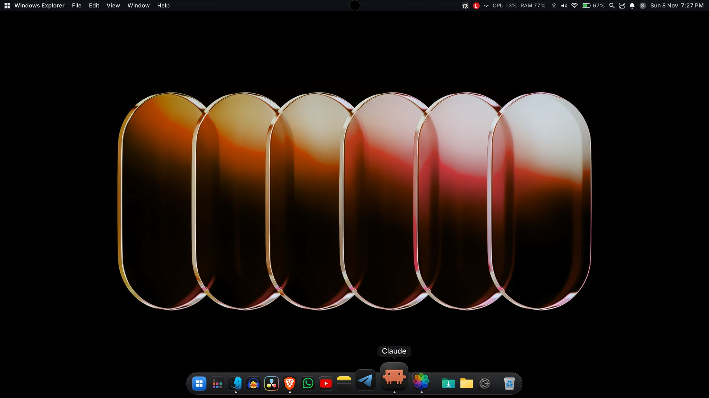
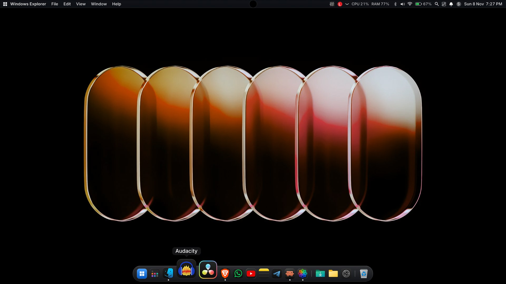
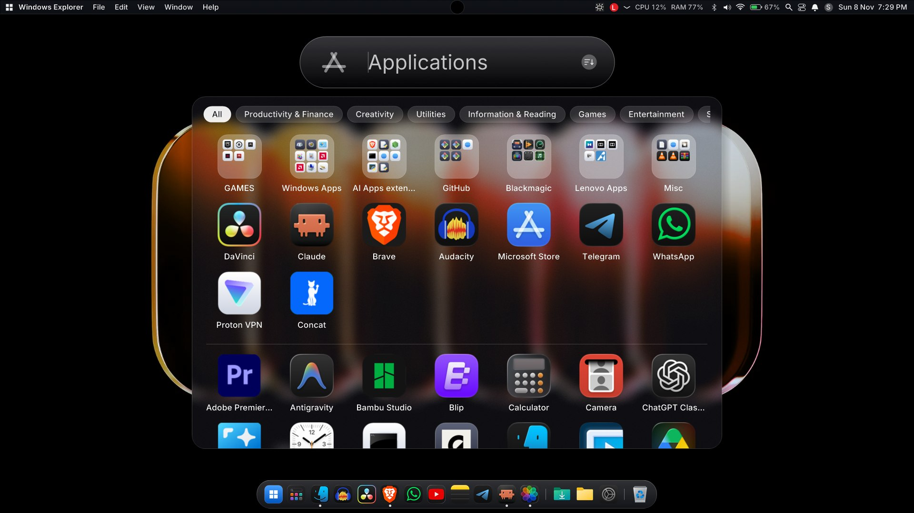
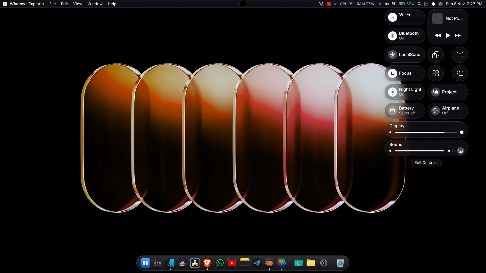
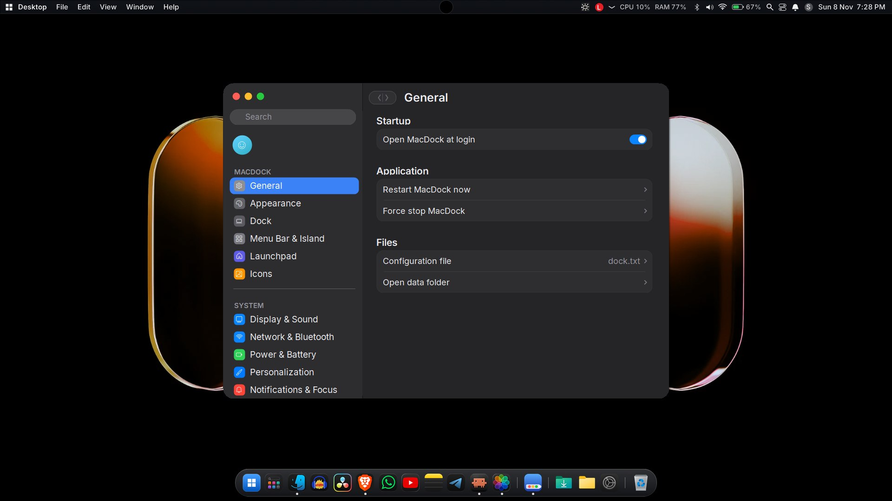
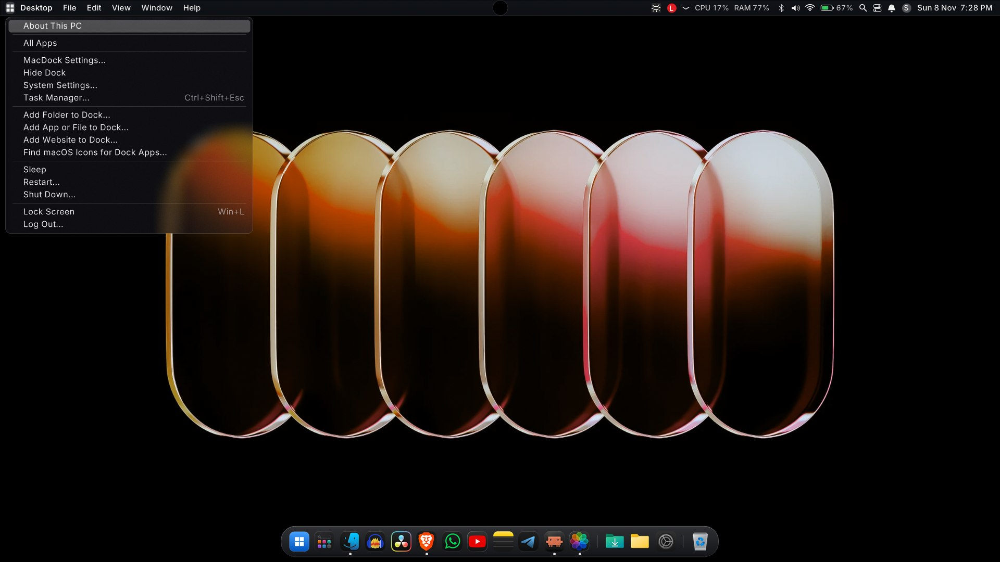

## MacDock v1.5

**SHA256 of MacDock-v1.5.zip:** 1509A8D1A70C52F1D7CA5DF835D70EEAF93941253E4FD7097E04813B1BB7895F

## Install
1. Download **MacDock-v1.5.zip** below and extract it.
2. Run `Install.bat` (per-user, no admin). If SmartScreen appears: **More info > Run anyway**.
3. MacDock installs to `%LOCALAPPDATA%\MacDock`, adds a Start Menu shortcut and starts (it also starts at login; toggle in Settings).

## Uninstall
Run `Uninstall.bat` (extracted folder or `%LOCALAPPDATA%\MacDock\Uninstall.bat`). It restores the taskbar, stops MacDock, removes autostart, the guard task, the shortcut and the install folder. If the taskbar stays hidden after a crash: `MacDock.exe /restore`.
## Why does Windows Defender flag MacDock?
Short version: **it is a false positive**, but it is understandable why it happens.

- **Unsigned, new, self-built.** The exe is built with the C# compiler that ships with Windows and has no code-signing certificate. Unsigned executables with few downloads have no reputation, so SmartScreen and Defender's cloud heuristics treat them cautiously.
- **It does the things a shell does.** MacDock uses global/low-level Windows hooks (keyboard, gestures), enumerates and thumbnails other apps' windows (window enumeration, DWM), applies glass effects with `SetWindowCompositionAttribute`, simulates input, hides or replaces taskbar behavior, and registers startup entries. Heuristic engines associate that combination with keyloggers and droppers, even though here it is used for the dock, menu bar and window previews.
- **What it does not do:** MacDock has no account and no analytics or telemetry code. Its network use is limited to LocalSend transfers with devices on your LAN, the optional macosicons.com icon lookup, and fetching favicons for website pins.

You do not have to take our word for it:
- The source is fully open in this repo. Read it, or build it yourself: `mac-dock\build.bat` (run it from a folder path without a `#` in it).
- Check the zip's SHA256 (listed in each release) and upload the file to [VirusTotal](https://www.virustotal.com/); a few engines may flag it heuristically.

**If Defender quarantined it:** Windows Security > Virus & threat protection > Protection history > select the item > Actions > **Restore** (or Allow on device). To stop it being re-flagged, add an exclusion: Virus & threat protection > Manage settings > Exclusions > Add or remove exclusions > Add an exclusion > Folder > `%LOCALAPPDATA%\MacDock`. Then re-run `Install.bat`.

**Help us:** you can report the false positive to Microsoft at <https://www.microsoft.com/en-us/wdsi/filesubmission> (choose "Software developer", upload the exe). Each accepted report improves detection for everyone.

## Screenshots (dark mode)

