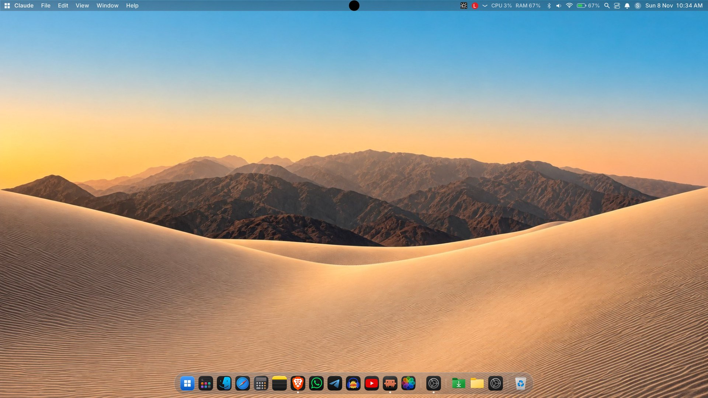
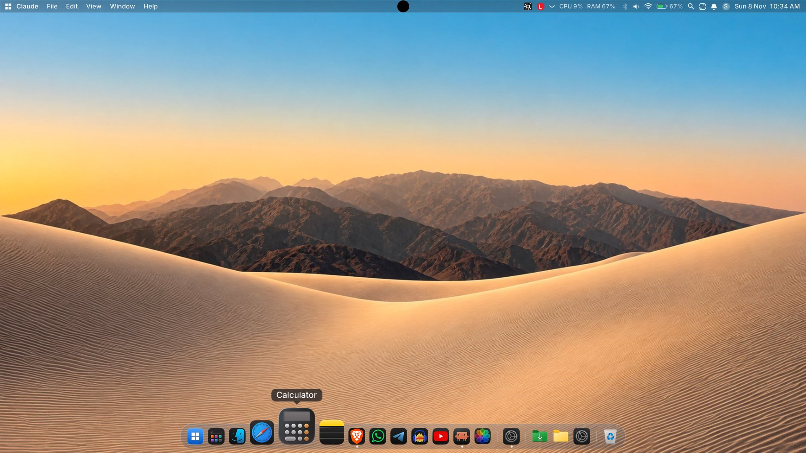
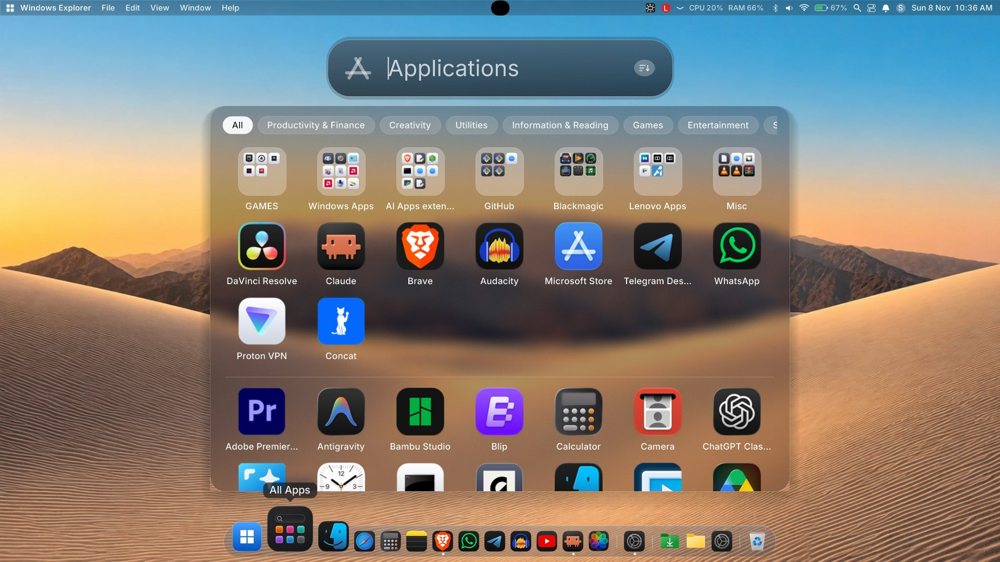
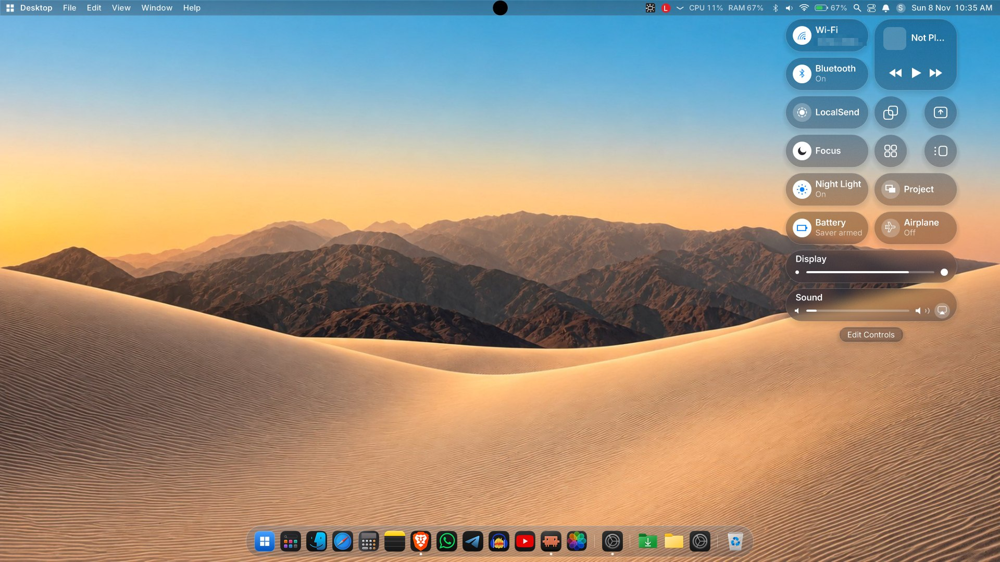
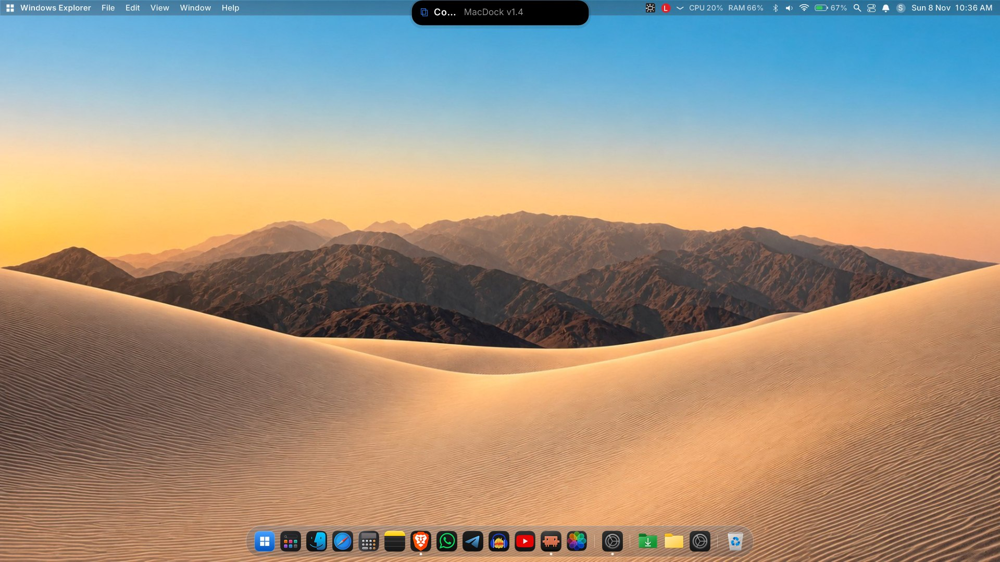
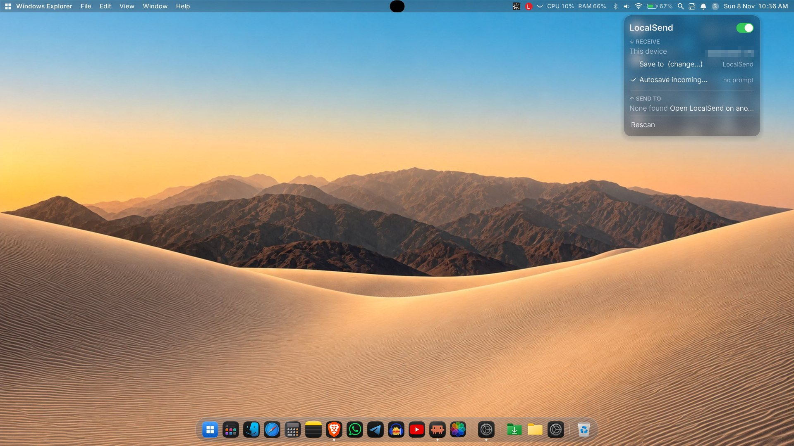
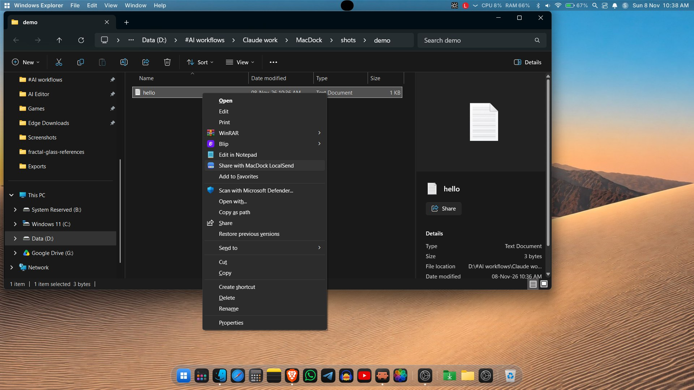
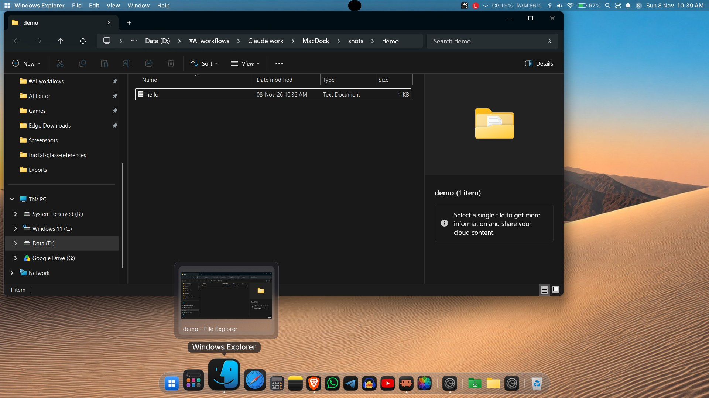
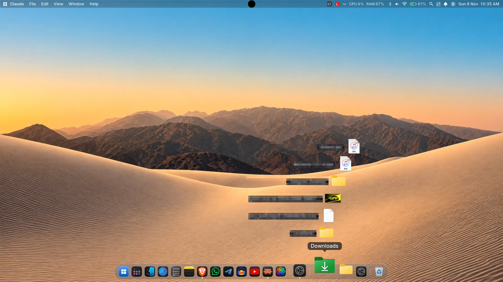
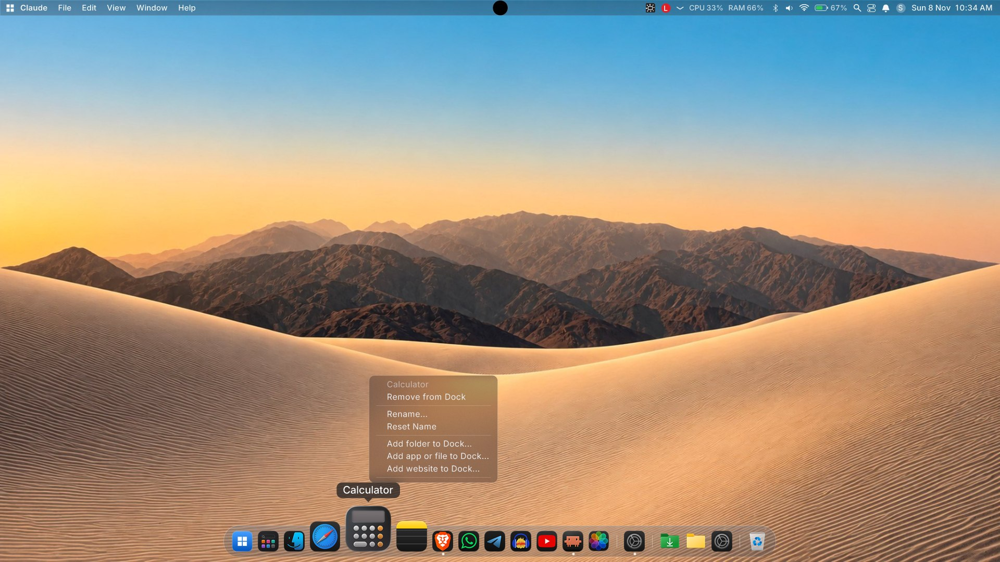

## MacDock v1.4
### Added
- **Reworked Genie minimize**: slice-based effect with a bottom-first pull, an accelerating curve and even frame pacing, so windows are sucked into (and restored from) the dock icon more smoothly.
- **LocalSend from Explorer**: a "Send to > MacDock LocalSend" shortcut and `MacDock.exe --send <file>` queue files for the LocalSend panel; optional autosave to accept incoming files without a prompt.
- **Keyboard access**: `Ctrl+Alt+Shift+D` puts the keyboard on the dock (arrows, Home/End, Enter to open, Menu key for the context menu, Esc to leave).
- **Multi-monitor and DPI**: choose the dock monitor (`monitor=` in `docksize.txt`); layout and fonts follow the monitor's DPI (per-monitor DPI manifest).
- **Windows theme and Reduce Motion**: follows the Windows colour mode and "Animation effects" switch; with animations off the bounce and open/close effects are instant.
- **Start-menu style Launchpad/All Apps motion**: short rise-and-fade open/close, prewarmed hidden copy, background-blurred backdrop.
- **Uninstall from Launchpad**: uses the program's own uninstaller (UAC when needed) and hides leftovers of programs that no longer exist.
- Window preview close button and an updated app logo used for every MacDock window.

### Changed
- Launched apps are brought to the front once their window appears; a single short bounce acknowledges a launch.
- Dragging a dock icon starts immediately (no long press).
- Settings window stays above the dock and maximizes into the area above it.
- Popup menus capture a margin around them so the glass blur is correct at the edges.
- MacDock relaunches itself through Explorer when started from a terminal or another app, so it is never tied to that process.
- Notifications and window-preview improvements, Win32 interop cleanups.

### Fixed
- Window previews and focus helpers when a window is minimized or topmost.
- Stale or missing icons in Launchpad.

**SHA256 of MacDock-v1.4.zip:** `24C0C321E1C6179EBDC03FF829DB85D4D29F6D4AA855E322C1880EDD46382C69`

## Install
1. Download **MacDock-v1.4.zip** below and extract it.
2. Run `Install.bat` (per-user, no admin). If SmartScreen appears: **More info > Run anyway**.
3. MacDock installs to `%LOCALAPPDATA%\MacDock`, adds a Start Menu shortcut and starts. Run `Uninstall.bat` to remove it.

Full guide in the [README](https://github.com/gadgetcue/MacDock#installation-guide).

## Why does Windows Defender flag MacDock?
Short version: **it is a false positive**, but it is understandable why it happens.

- **Unsigned, new, self-built.** The exe is built with the C# compiler that ships with Windows and has no code-signing certificate. Unsigned executables with few downloads have no reputation, so SmartScreen and Defender's cloud heuristics treat them cautiously.
- **It does the things a shell does.** MacDock uses global/low-level Windows hooks (keyboard, gestures), enumerates and thumbnails other apps' windows (window enumeration, DWM), applies glass effects with `SetWindowCompositionAttribute`, simulates input, hides or replaces taskbar behavior, and registers startup entries. Heuristic engines associate that combination with keyloggers and droppers, even though here it is used for the dock, menu bar and window previews.
- **What it does not do:** MacDock has no account and no analytics or telemetry code. Its network use is limited to LocalSend transfers with devices on your LAN, the optional macosicons.com icon lookup, and fetching favicons for website pins.

You do not have to take our word for it:
- The source is fully open in this repo. Read it, or build it yourself: `mac-dock\build.bat` (run it from a folder path without a `#` in it).
- Check the zip's SHA256 (listed in each release) and upload the file to [VirusTotal](https://www.virustotal.com/); a few engines may flag it heuristically.

**If Defender quarantined it:** Windows Security > Virus & threat protection > Protection history > select the item > Actions > **Restore** (or Allow on device). To stop it being re-flagged, add an exclusion: Virus & threat protection > Manage settings > Exclusions > Add or remove exclusions > Add an exclusion > Folder > `%LOCALAPPDATA%\MacDock`. Then re-run `Install.bat`.

**Help us:** you can report the false positive to Microsoft at <https://www.microsoft.com/en-us/wdsi/filesubmission> (choose "Software developer", upload the exe). Each accepted report improves detection for everyone.

## Screenshots

