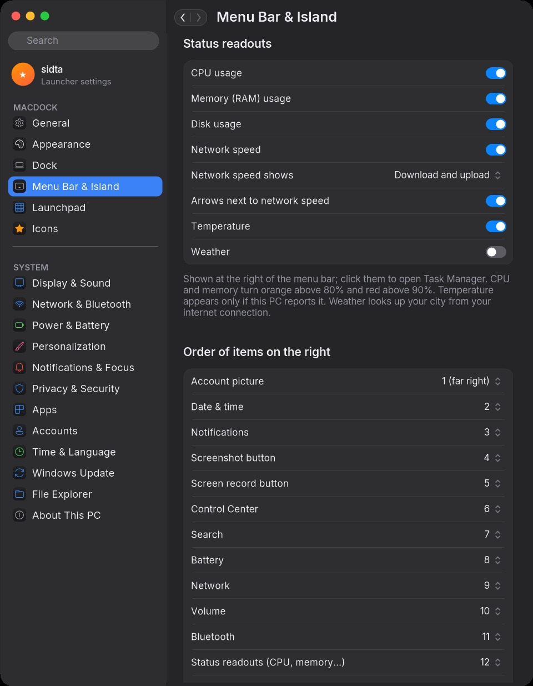
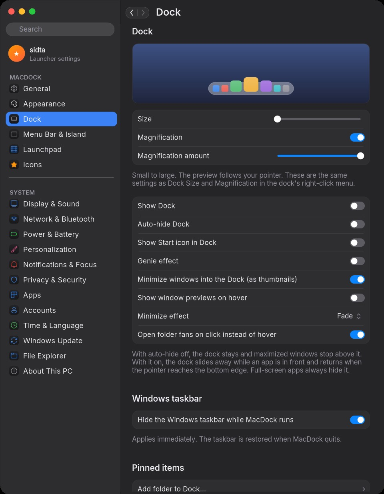
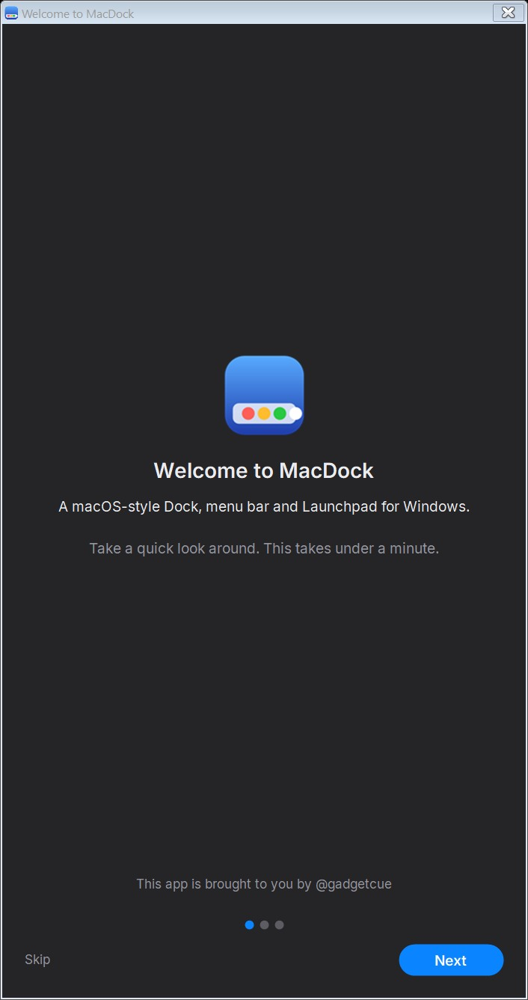

## MacDock v2.3

Faster idle, plus the biggest batch of new features since v2.0: status readouts in the menu bar, per-app volume, a minimize-effect picker, minimized windows as dock tiles, a redesigned welcome tour and a single-file installer.


### Performance (measured on one PC, dock idle)
- The menu bar re-read and re-parsed `dock.txt` about 100 times a second. Settings lookups are now remembered until the file changes. Bar update cost went from about 800 ms to about 130 ms of UI time per 10 s, and total idle CPU from about 2.3 s to about 1.2 s per 20 s (about 45% less).
- Startup time is unchanged: about 2 s of CPU to show the bar on a warm restart. The first start after installing a new build is slower because icons are rebuilt once and then cached.

### New
- **Status readouts** (all off by default): disk usage, network speed (download, upload or both, with or without arrows), temperature where the PC reports it, and weather. CPU/RAM turn orange above 80% and red above 90%; the battery icon turns orange below 20% and red at 10%.
- **Per-app volume** sliders in the Sound panel.
- **Minimize effect**: Genie, Scale or Fade, and a smoother Genie.
- **Minimize into the Dock**: minimized windows appear as thumbnail tiles before the Recycle Bin; click to restore. Optional hover window previews.
- **Per-app hidden dock**: `@hide-dock-apps=chrome.exe,code.exe` auto-hides the dock while those apps are in front.
- **Menu bar items** can be reordered and spaced; double-click empty bar space to maximize or restore the front window.
- **Settings > Menu Bar & Island** regrouped into clearer sections.
- **Dynamic Island notifications**: new layout with the app's artwork.
- **Folder fan**: thumbnails keep their aspect ratio, videos show a frame, and no item shows a blank tile.
- **Redesigned welcome tour**, full height and DPI-aware.
- **Single-file installer**: `MacDock-Setup.exe`.
- Trash: middle-click, or Ctrl/Shift-click, empties the Recycle Bin.

### Fixed
- Settings is no longer a topmost window.
- The Windows taskbar stays hidden across an auto-update.
- Crash and hang safety nets: no "Not responding" ghosting, background-thread errors are logged instead of ending the process, and a dock frozen for 60 s restarts itself.
- Settings no longer freezes the dock on first open.






### Install
- **Easiest:** run `MacDock-Setup.exe` (no admin needed).
- **Or:** extract `MacDock-v2.3.zip` and run `Install.bat`. The in-app updater uses the zip.

### The exe is unsigned: SmartScreen and Defender
MacDock is built with the C# compiler that ships with Windows and has **no code-signing certificate**. Windows SmartScreen may show "Windows protected your PC", and Defender may flag it. This is a false positive caused by no reputation plus shell-like behavior (window hooks, thumbnails, taskbar control), not by any hidden code: MacDock has no account and no telemetry.
- SmartScreen: click **More info > Run anyway**.
- Defender: restore from Protection history and add an exclusion for the install folder, or submit the file as a false positive at https://www.microsoft.com/en-us/wdsi/filesubmission (choose "Software developer", upload the exe).
- Real fix: sign the exe. Options are an OV/EV code-signing certificate (EV clears SmartScreen at once; OV builds reputation over time), or Azure Trusted Signing. Neither is set up yet.

### Checksums (SHA256)
```
MacDock-v2.3.zip       c93921ae3006b59a5f424eb8d092e913189c12d68720f96460bac2bf46a42a03
MacDock-Setup.exe      924f9d217a07e54f4de0f0d8d0cd4bca519a70c399177d6f8478c1969e916662
```
